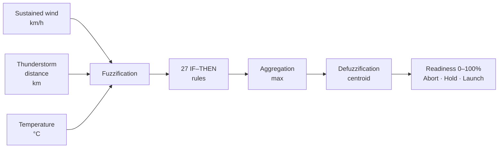

# fuzzy-launch-decision

A Mamdani fuzzy expert system that rates whether the weather allows a rocket launch. It takes the sustained wind, the distance to the nearest thunderstorm and the temperature, and returns a **launch readiness score from 0 to 100%**, read as one of three decisions: **Abort**, **Hold** or **Launch**.

Individual project for the course *Inteligência Artificial e Bioinspirada* (Artificial and Bio-inspired Intelligence), open-loop track.

> **Language note:** the notebook, the data files and their column names are written in Portuguese. In the notebook and the CSVs, the three decisions appear as *Abortar*, *Aguardar* and *Lançar*.

## The problem

Before every launch, a weather team assesses whether conditions allow the countdown to continue (*go*) or not (*no-go*). The official criteria are hard limits, such as "do not launch if the sustained wind exceeds 30 mph". Close to those limits, however, risk grows gradually: a 45 km/h wind is not as safe as a 10 km/h one, even though both are below the limit.

Fuzzy logic captures that gradation with linguistic terms (weak, moderate, strong), the way an expert reasons. The model's thresholds come from weather criteria published by NASA, and the validation uses real launches, including Challenger in 1986.

## How it works



### Variables

| Variable | Type | Domain | Terms |
| --- | --- | --- | --- |
| Sustained wind | Input | 0–80 km/h | Weak · Moderate · Strong |
| Thunderstorm distance | Input | 0–50 km (50 = no storm) | Near · Medium · Far |
| Temperature | Input | −10 to 45 °C | Cold · Mild · Hot |
| Launch readiness | Output | 0–100% | Abort · Hold · Launch |

The transitions between terms sit around the official limits: about 48 km/h for wind (Falcon 9), 18.5 km for lightning, and 4.4 to 35 °C for temperature (Artemis I). Values outside a domain are clipped to its nearest edge.

### Rule base

There are 27 rules, one for each combination of terms (3 × 3 × 3), so the rule base is complete:

1. Any **critical** condition (Strong wind, Near storm or Cold temperature) → **Abort**.
2. With no critical condition, the **caution** conditions (Moderate wind, Medium storm distance or Hot temperature) are counted:
   - none → **Launch**;
   - one → **Hold**;
   - two or more → **Abort**.

### Inference

Mamdani inference with AND = min, implication = min, aggregation = max and centroid defuzzification. Mamdani was chosen because the output is also linguistic and every step of the calculation can be shown graphically.

Reading the output: below 35% → Abort; 35–65% → Hold; above 65% → Launch.

## Repository layout

```
fuzzy-launch-decision/
├── notebook/
│   └── lancamento_fuzzy.ipynb    # notebook: implementation and full explanation
├── requirements.txt              # pinned dependencies (includes scipy and networkx, which scikit-fuzzy needs)
├── README.md
└── data/
    ├── criterios_referencia.csv  # official limits behind the model
    └── casos_reais.csv           # real launches used for validation
```

## Running it

Requires Python 3.12 or newer: the pinned versions of numpy, scipy and networkx need it. Tested with Python 3.14.5 on Windows 11.

```bash
git clone https://github.com/kiovaz/fuzzy-launch-decision.git
cd fuzzy-launch-decision

python -m venv .venv            # use python3 if python is not found
source .venv/bin/activate        # Windows: .venv\Scripts\activate

pip install -r requirements.txt
jupyter notebook notebook/lancamento_fuzzy.ipynb
```

In Jupyter, use **Kernel > Restart Kernel and Run All Cells…**. The notebook runs from top to bottom with no manual steps.

To execute it from the command line instead:

```bash
jupyter nbconvert --to notebook --execute --inplace notebook/lancamento_fuzzy.ipynb
```

The notebook reads the CSVs from `../data`, relative to its own folder; Jupyter and `nbconvert` both run it from `notebook/`, so the commands above work from the repository root.

A full run took between 35 seconds and a little over a minute on the development machine. The slowest cell is Validation A, which evaluates 68,921 input combinations using scikit-fuzzy's vectorised mode and prints its own run time.

## What the notebook covers

- Membership function plots for every input and the output, with the reasoning behind each one
- The full table of 27 rules
- **6 test cases** (typical, extreme and transition), each with the rules it fires and a plot of the aggregated output and its centroid
- **3 output surfaces**, one per pair of inputs, plus curves showing how each input alone moves the score
- **Validation A:** comparison against the official criteria applied as yes/no rules over a grid of input combinations, with a confusion matrix
- **Validation B:** three real launches, Challenger (1986), a Falcon 9 (2025) and a Delta IV (2002), compared with the official forecasts
- Conclusions and limitations

## Results

All numbers below come from a clean run of the notebook (`nbconvert --execute`, no errors). In every test, exactly the rules expected beforehand fired.

### Test cases

| # | Wind (km/h) | Storm (km) | Temp. (°C) | Expected | Result | Rules fired (strength) |
| --- | --- | --- | --- | --- | --- | --- |
| 1 | 10 | 50 | 24 | Launch | 84.44% · Launch | R1 (1.00) |
| 2 | 22 | 50 | 2 | Abort | 17.47% · Abort | R3 (0.53), R12 (0.13) |
| 3 | 60 | 5 | 25 | Abort (system minimum) | 15.56% · Abort | R25 (1.00) |
| 4 | 45 | 50 | 24 | Between Hold and Abort | 33.35% · Abort | R10 (0.33), R19 (0.33) |
| 5 | 10 | 50 | 6 | About 50%, read as Hold | 50.00% · Hold | R1 (0.33), R3 (0.33) |
| 6 | 35 | 25 | 24 | Abort | 15.56% · Abort | R13 (1.00) |

Test 4 lands 1.65 points below the 35% Hold threshold: with both rules at the same strength, the clipped Abort set is wider than the Hold set and pulls the centroid down. Test 5 reads as Hold even though no Hold rule fires, because the centroid sits halfway between Abort and Launch.

### Real launches

| Case | Readiness | Reading | Official reference (100% − P(violation)) |
| --- | --- | --- | --- |
| Challenger (1986) | 17.47% | Abort | No probability published; launched and broke apart at 73 s |
| Falcon 9 Starlink 6-95, 24 h delay option (2025) | 66.80% | Launch, at the border | 95% (the model's maximum is 84.44%, and the 25 km/h wind is already partly Moderate) |
| Delta IV (2002) | 17.53% | Abort | 20% |

### Validation A: official criteria vs. fuzzy system

Over a grid of 41 × 41 × 41 = 68,921 input combinations:

- **93.40% agreement**, or 82.04% if Hold is not counted as agreement.
- **Zero cases** where the fuzzy system says Launch and the official criteria forbid it. All 4,547 disagreements (with Hold counted as agreement) go the safe way: the official criteria allow the launch and the fuzzy system aborts.

| Official criteria ↓ · Fuzzy → | Abort | Hold | Launch |
| --- | ---: | ---: | ---: |
| Allowed | 4,547 | 6,374 | 3,379 |
| Forbidden | 53,165 | 1,456 | 0 |

All 1,456 "Forbidden → Hold" points are temperatures above 35 °C, where the model deliberately treats heat as a caution condition. Of the divergences, 46.4% come only from the two-caution-conditions rule, 15.6% only from the critical terms (Strong, Cold, Near) starting slightly before the official limits, and 38.1% from both at once.

## Data

The CSVs are UTF-8 with BOM, comma-separated, with a dot as the decimal mark. In Excel versions that use the semicolon as the list separator (common in Brazil and much of Europe), open them through **Data > Get Data > From Text/CSV**: a double-click puts everything in a single column.

Every row includes its source and link. The `observacoes` (notes) column in `casos_reais.csv` says which values were measured and which were estimated.

## Limitations

- Only three weather factors are modelled: clouds, precipitation and upper-level winds are left out.
- Limits from different rockets are combined into a single model.
- The sources measure wind at different heights, and gusts are ignored.
- The rule base is conservative: 23 of the 27 rules lead to Abort.
- Because of the centroid, the output stays between about 15.6% and 84.4% and never reaches 0% or 100%.
- This is an academic exercise and is not meant for real launch decisions.

## References

- ZADEH, L. A. Fuzzy sets. *Information and Control*, v. 8, n. 3, p. 338–353, 1965. [DOI](https://doi.org/10.1016/S0019-9958(65)90241-X)
- MAMDANI, E. H.; ASSILIAN, S. An experiment in linguistic synthesis with a fuzzy logic controller. *International Journal of Man-Machine Studies*, v. 7, n. 1, p. 1–13, 1975. [DOI](https://doi.org/10.1016/S0020-7373(75)80002-2)
- TAKAGI, T.; SUGENO, M. Fuzzy identification of systems and its applications to modeling and control. *IEEE Transactions on Systems, Man, and Cybernetics*, v. SMC-15, n. 1, p. 116–132, 1985. [DOI](https://doi.org/10.1109/TSMC.1985.6313399)
- ROSS, T. J. *Fuzzy Logic with Engineering Applications*. 4th ed. Chichester: Wiley, 2016.
- [scikit-fuzzy documentation](https://scikit-fuzzy.readthedocs.io)
- [NASA – Falcon 9 Crew Dragon Launch Weather Criteria](https://www.nasa.gov/wp-content/uploads/2021/07/falcon9_crewdragon_launch_weather_criteria_fact_sheet.pdf)
- [NASA – Artemis I Weather Criteria](https://www.nasa.gov/content/artemis-i-weather-criteria)
- [NASA – Space Shuttle Weather Launch Commit Criteria](https://www3.nasa.gov/centers/kennedy/pdf/633165main_weather-rules-march2011.pdf)
- [NASA TM-86577 – Atmospheric Environment for Space Shuttle (STS-51L) Launch](https://ntrs.nasa.gov/citations/19870009517)
- [Report of the Presidential Commission on the Space Shuttle Challenger Accident, ch. III](https://www.nasa.gov/history/rogersrep/v1ch3.htm)
- [45th Weather Squadron – Falcon 9 Starlink 6-95 launch forecast](https://45thweathersquadron.nebula.spaceforce.mil/assets/LaunchForecasts/Falcon%209%20Starlink%206-95%20L-1%20Forecast%20-%202%20Dec%20Launch.pdf)
- [Spaceflight Now – Delta IV launch weather forecast](https://spaceflightnow.com/delta/delta4/021114weather)

## Author

Caio Vasconcelos ([@kiovaz](https://github.com/kiovaz))